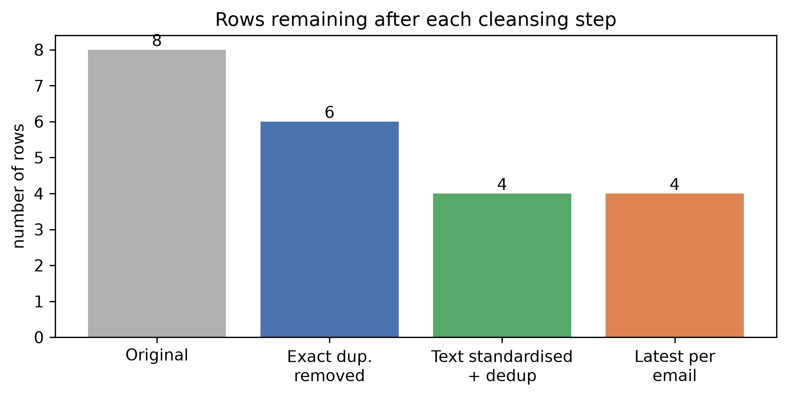

# Experiment 3: Data cleansing: remove redundancy

> **File:** `exp3.py`  |  **Tools:** Python 3.13, pandas and Matplotlib, MacOS

## 🎯 Aim

Write a data cleansing program to remove redundancy (duplicate records) from data.

## 📘 Theory

Redundancy means that the same real-world entity is stored more than once. It happens when data is collected from several sources or typed again and again. Duplicates waste storage, give wrong counts and totals, and slow down analysis, so they must be removed during the transformation stage of ETL. Duplicates are of two kinds: exact copies of a row, and near duplicates that differ only in spaces, capital letters or old versions of the same record.

- **Exact duplicates**: all the columns are identical; found with duplicated() and removed with drop_duplicates().
- **Near duplicates**: the same person with different spacing or letter case; the text is standardised first and then compared.
- **Key based removal**: records with the same unique key (here the e-mail) are reduced to one record.
- **Survivorship rule**: when two records conflict, the latest updated record is kept.

## 🪜 Algorithm / Steps

1. Create a customer table of 8 records containing exact and near duplicates.
2. Count and drop the exact duplicate rows.
3. Trim the text, convert names to Proper Case and e-mails to lower case, then drop duplicates on name and e-mail.
4. Sort by the update date and keep only the latest record of every e-mail address.
5. Show the final table and a bar chart of the rows left after every step.

## 💻 Code

```python
import pandas as pd
import matplotlib.pyplot as plt

rows = [
    (101, "Rahul Sharma",  "rahul@mail.com",  "Delhi",  "2025-01-10"),
    (102, "Priya Verma",   "priya@mail.com",  "Mumbai", "2025-01-11"),
    (101, "Rahul Sharma",  "rahul@mail.com",  "Delhi",  "2025-01-10"),
    (103, "John Smith",    "john@mail.com",   "Pune",   "2025-01-12"),
    (104, " priya verma ", "PRIYA@mail.com",  "Mumbai", "2025-01-11"),
    (105, "Aman Gupta",    "aman@mail.com",   "Noida",  "2025-01-13"),
    (103, "John Smith",    "john@mail.com",   "Pune",   "2025-01-12"),
    (106, "Aman Gupta",    "aman@mail.com",   "Gurgaon","2025-01-20"),
]
df = pd.DataFrame(rows, columns=["id", "name", "email", "city", "updated"])
print("Original data :", len(df), "rows")
print(df.to_string(index=False))

print("\nExact duplicate rows found:", df.duplicated().sum())
step1 = df.drop_duplicates()
print("After removing exact duplicates:", len(step1), "rows")

step2 = step1.copy()
step2["name"] = step2["name"].str.strip().str.title()
step2["email"] = step2["email"].str.strip().str.lower()
step2 = step2.drop_duplicates(subset=["name", "email"])
print("After standardising text and removing duplicates:",
      len(step2), "rows")

step3 = step2.sort_values("updated").drop_duplicates("email", keep="last")
step3 = step3.sort_values("id")
print("After keeping latest record per email:", len(step3), "rows")
print("\nFinal clean table")
print(step3.to_string(index=False))

sizes = [len(df), len(step1), len(step2), len(step3)]
labels = ["Original", "Exact dup.\nremoved",
          "Text standardised\n+ dedup", "Latest per\nemail"]
plt.figure(figsize=(7, 3.6))
bars = plt.bar(labels, sizes,
               color=["#b0b0b0", "#4c72b0", "#55a868", "#dd8452"])
for b in bars:
    plt.text(b.get_x() + b.get_width() / 2, b.get_height() + 0.1,
             int(b.get_height()), ha="center")
plt.ylabel("number of rows")
plt.title("Rows remaining after each cleansing step")
plt.tight_layout()
plt.show()
```

## 🖥️ Output

```text
Original data : 8 rows
 id          name          email    city    updated
101  Rahul Sharma rahul@mail.com   Delhi 2025-01-10
102   Priya Verma priya@mail.com  Mumbai 2025-01-11
101  Rahul Sharma rahul@mail.com   Delhi 2025-01-10
103    John Smith  john@mail.com    Pune 2025-01-12
104  priya verma  PRIYA@mail.com  Mumbai 2025-01-11
105    Aman Gupta  aman@mail.com   Noida 2025-01-13
103    John Smith  john@mail.com    Pune 2025-01-12
106    Aman Gupta  aman@mail.com Gurgaon 2025-01-20

Exact duplicate rows found: 2
After removing exact duplicates: 6 rows
After standardising text and removing duplicates: 4 rows
After keeping latest record per email: 4 rows

Final clean table
 id         name          email   city    updated
101 Rahul Sharma rahul@mail.com  Delhi 2025-01-10
102  Priya Verma priya@mail.com Mumbai 2025-01-11
103   John Smith  john@mail.com   Pune 2025-01-12
105   Aman Gupta  aman@mail.com  Noida 2025-01-13
```

<p align="center"><br/><sub>Figure</sub></p>

## ✅ Result

The table was reduced from 8 rows to 6 after removing exact duplicates and to 4 after standardising the text. The final clean table contains one record for each of the 4 customers.

## 🎤 Viva Questions

**Q. What is data redundancy?**  
A. The same real world entity stored more than once.

**Q. What is the difference between an exact and a near duplicate?**  
A. An exact duplicate is equal in all fields; a near duplicate differs slightly, for example in spelling or capitals.

**Q. How was similarity of two names measured?**  
A. With the ratio of difflib.SequenceMatcher, a number between 0 and 1.

**Q. Why remove duplicates before analysis?**  
A. They make counts, sums and averages wrong and waste storage.

**Q. What is a blocking key?**  
A. A field, such as the phone number, used to decide which records are compared.

---
[⬅ Back to index](README.md)
