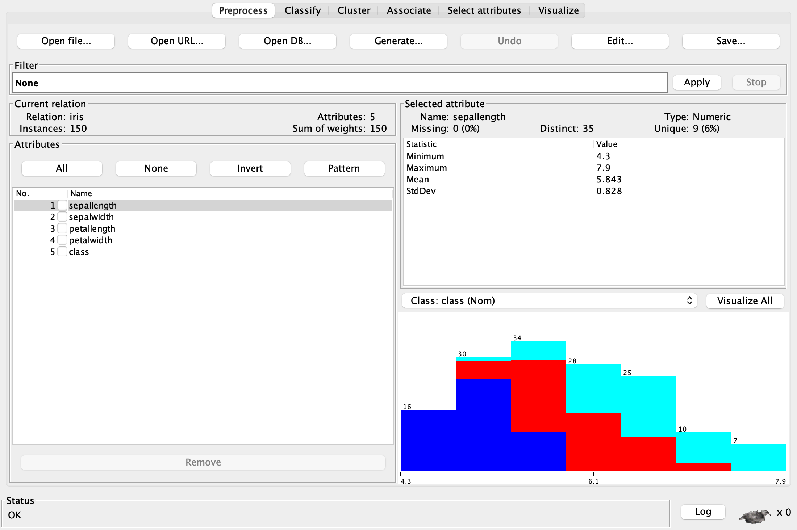

# Experiment 4: Introduction to WEKA tool

> **File:** `IntroWeka.java`  |  **Tools:** WEKA 3.8.6, Java Development Kit (JDK) 17.0.16, MacOS

## 🎯 Aim

Study the WEKA tool and its main components, and load an ARFF dataset using the WEKA Java API.

## 📘 Theory

WEKA (Waikato Environment for Knowledge Analysis) is a free, open-source collection of machine learning algorithms for data mining, written in Java at the University of Waikato, New Zealand. It can be used through a graphical interface or from Java code. It reads data in ARFF (Attribute-Relation File Format), a text file which has a header describing the attributes and a data section holding the records.

- **Explorer**: the main window with the tabs Preprocess, Classify, Cluster, Associate, Select attributes and Visualize.
- **Experimenter**: runs and compares several algorithms on several datasets.
- **Knowledge Flow**: drag and drop interface to build a data flow.
- **Simple CLI**: command line interface to run WEKA classes.
- **ARFF file**: @relation gives the name, @attribute lines declare the columns and types, and @data starts the records.

## 🪜 Algorithm / Steps

1. Install WEKA 3.8.6 and JDK 17 and start the Explorer.
2. Open the Preprocess tab and load the iris.arff dataset from the data folder.
3. Read the summary of the attributes, their types and their statistics.
4. Write a Java program that loads the same file with DataSource and sets the class attribute.
5. Print the relation name, number of instances, attributes, their statistics and the class distribution.

## 💻 Code

```java
import weka.core.Attribute;
import weka.core.AttributeStats;
import weka.core.Instances;
import weka.core.converters.ConverterUtils.DataSource;

public class IntroWeka {
    public static void main(String[] args) throws Exception {
        Instances data = DataSource.read("data/iris.arff");
        data.setClassIndex(data.numAttributes() - 1);

        System.out.println("Relation   : " + data.relationName());
        System.out.println("Instances  : " + data.numInstances());
        System.out.println("Attributes : " + data.numAttributes());
        System.out.println("Class      : " + data.classAttribute().name());
        System.out.println();

        for (int i = 0; i < data.numAttributes(); i++) {
            Attribute a = data.attribute(i);
            AttributeStats st = data.attributeStats(i);
            if (a.isNumeric()) {
                System.out.printf("%d. %-12s numeric  min=%.1f max=%.1f "
                    + "mean=%.2f sd=%.2f%n", i + 1, a.name(),
                    st.numericStats.min, st.numericStats.max,
                    st.numericStats.mean, st.numericStats.stdDev);
            } else {
                System.out.printf("%d. %-12s nominal  %s%n", i + 1,
                    a.name(), a.toString().replaceAll(".*\\{", "{"));
            }
        }

        System.out.println("\nClass distribution:");
        int[] counts = data.attributeStats(data.classIndex()).nominalCounts;
        for (int c = 0; c < counts.length; c++) {
            System.out.println("  " + data.classAttribute().value(c)
                + " = " + counts[c]);
        }
        System.out.println("\nFirst 3 instances:");
        for (int i = 0; i < 3; i++) {
            System.out.println("  " + data.instance(i));
        }
    }
}
```

> Compile and run: `javac -cp weka.jar IntroWeka.java` then `java -cp .:weka.jar IntroWeka` (the `data/` folder is in this repo).

## 🖥️ Output

```text
Relation   : iris
Instances  : 150
Attributes : 5
Class      : class

1. sepallength  numeric  min=4.3 max=7.9 mean=5.84 sd=0.83
2. sepalwidth   numeric  min=2.0 max=4.4 mean=3.05 sd=0.43
3. petallength  numeric  min=1.0 max=6.9 mean=3.76 sd=1.76
4. petalwidth   numeric  min=0.1 max=2.5 mean=1.20 sd=0.76
5. class        nominal  {Iris-setosa,Iris-versicolor,Iris-virginica}

Class distribution:
  Iris-setosa = 50
  Iris-versicolor = 50
  Iris-virginica = 50

First 3 instances:
  5.1,3.5,1.4,0.2,Iris-setosa
  4.9,3,1.4,0.2,Iris-setosa
  4.7,3.2,1.3,0.2,Iris-setosa
```

<p align="center"><br/><sub>WEKA Explorer</sub></p>

## ✅ Result

The iris.arff dataset has 150 instances and 5 attributes (four numeric measurements and one nominal class). The mean of sepallength is 5.84 and of petalwidth is 1.20, and every one of the three classes (Iris-setosa, Iris-versicolor, Iris-virginica) has exactly 50 instances. The same summary is seen in the Preprocess tab of the Explorer.

## 🎤 Viva Questions

**Q. What does WEKA stand for?**  
A. Waikato Environment for Knowledge Analysis.

**Q. What are the tabs of the WEKA Explorer?**  
A. Preprocess, Classify, Cluster, Associate, Select attributes and Visualize.

**Q. What is an ARFF file?**  
A. The Attribute-Relation File Format: @relation, @attribute lines and @data rows.

**Q. What is the class attribute?**  
A. The column that is to be predicted.

**Q. In which language is WEKA written?**  
A. Java, so it can also be used from Java code.

---
[⬅ Back to index](README.md)
