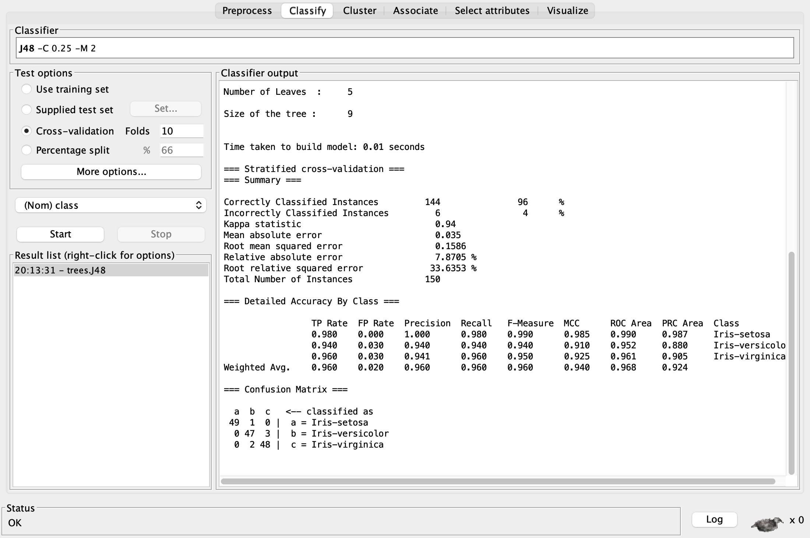

# Experiment 5: Classification on ARFF files using WEKA

> **File:** `ClassifyWeka.java`  |  **Tools:** WEKA 3.8.6, Java Development Kit (JDK) 17.0.16, MacOS

## 🎯 Aim

Implement classification on an ARFF file using WEKA and compare the J48 decision tree with the Naive Bayes classifier.

## 📘 Theory

Classification is a supervised data mining technique that learns a model from records whose class is known and then uses it to predict the class of new records. In WEKA the class is the last attribute by default. A model is evaluated with k-fold cross validation: the data is split into k parts, the model is trained on k−1 parts and tested on the remaining part, and this is repeated k times. The results are measured with the following quantities:

- **J48**: WEKA's version of the C4.5 decision tree algorithm, which splits the data using the attribute with the highest information gain ratio.
- **Naive Bayes**: a probabilistic classifier that assumes the attributes are independent of each other.
- **Confusion matrix**: a table showing how many records of each class were predicted as each class.
- **Kappa statistic**: agreement between the predicted and actual classes after removing the effect of chance.

### 📐 Formulas

$$ \text{Accuracy} = \frac{TP + TN}{TP + TN + FP + FN} $$

$$ \text{Precision} = \frac{TP}{TP + FP}, \qquad \text{Recall} = \frac{TP}{TP + FN} $$

$$ F_1 = \frac{2 \times \text{Precision} \times \text{Recall}}{\text{Precision} + \text{Recall}} $$

## 🪜 Algorithm / Steps

1. Load iris.arff and set the last attribute (class) as the target.
2. Create the J48 and Naive Bayes classifiers.
3. Evaluate each one with 10-fold cross validation.
4. Print the accuracy, kappa, error, precision, recall, F-measure and the confusion matrix.
5. Build J48 on the full data and print the learned decision tree.

## 💻 Code

```java
import java.util.Random;
import weka.classifiers.Classifier;
import weka.classifiers.Evaluation;
import weka.classifiers.bayes.NaiveBayes;
import weka.classifiers.trees.J48;
import weka.core.Instances;
import weka.core.converters.ConverterUtils.DataSource;

public class ClassifyWeka {
    public static void main(String[] args) throws Exception {
        Instances data = DataSource.read("data/iris.arff");
        data.setClassIndex(data.numAttributes() - 1);

        Classifier[] models = {new J48(), new NaiveBayes()};
        String[] names = {"J48 (decision tree)", "Naive Bayes"};

        for (int m = 0; m < models.length; m++) {
            Evaluation eval = new Evaluation(data);
            eval.crossValidateModel(models[m], data, 10, new Random(1));

            System.out.println("=== " + names[m] + " : 10-fold CV ===");
            System.out.printf("Correctly classified : %.0f of %.0f "
                + "(%.2f %%)%n", eval.correct(), eval.numInstances(),
                eval.pctCorrect());
            System.out.printf("Kappa statistic      : %.4f%n",
                eval.kappa());
            System.out.printf("Mean absolute error  : %.4f%n",
                eval.meanAbsoluteError());
            System.out.printf("Weighted precision   : %.3f%n",
                eval.weightedPrecision());
            System.out.printf("Weighted recall      : %.3f%n",
                eval.weightedRecall());
            System.out.printf("Weighted F-measure   : %.3f%n",
                eval.weightedFMeasure());
            System.out.println(eval.toMatrixString("Confusion matrix"));
        }

        J48 tree = new J48();
        tree.buildClassifier(data);
        System.out.println("=== J48 tree built on full data ===");
        System.out.println(tree);
    }
}
```

> Compile and run: `javac -cp weka.jar ClassifyWeka.java` then `java -cp .:weka.jar ClassifyWeka` (the `data/` folder is in this repo).

## 🖥️ Output

```text
=== J48 (decision tree) : 10-fold CV ===
Correctly classified : 144 of 150 (96.00 %)
Kappa statistic      : 0.9400
Mean absolute error  : 0.0350
Weighted precision   : 0.960
Weighted recall      : 0.960
Weighted F-measure   : 0.960
Confusion matrix
  a  b  c   <-- classified as
 49  1  0 |  a = Iris-setosa
  0 47  3 |  b = Iris-versicolor
  0  2 48 |  c = Iris-virginica

=== Naive Bayes : 10-fold CV ===
Correctly classified : 144 of 150 (96.00 %)
Kappa statistic      : 0.9400
Mean absolute error  : 0.0342
Weighted precision   : 0.960
Weighted recall      : 0.960
Weighted F-measure   : 0.960
Confusion matrix
  a  b  c   <-- classified as
 50  0  0 |  a = Iris-setosa
  0 48  2 |  b = Iris-versicolor
  0  4 46 |  c = Iris-virginica

=== J48 tree built on full data ===
J48 pruned tree
------------------

petalwidth <= 0.6: Iris-setosa (50.0)
petalwidth > 0.6
|   petalwidth <= 1.7
|   |   petallength <= 4.9: Iris-versicolor (48.0/1.0)
|   |   petallength > 4.9
|   |   |   petalwidth <= 1.5: Iris-virginica (3.0)
|   |   |   petalwidth > 1.5: Iris-versicolor (3.0/1.0)
|   petalwidth > 1.7: Iris-virginica (46.0/1.0)

Number of Leaves  :     5

Size of the tree :     9
```

<p align="center"><br/><sub>WEKA Explorer</sub></p>

## ✅ Result

Both J48 and Naive Bayes classified 144 of the 150 instances correctly, an accuracy of 96.00 % with a kappa of 0.94. The confusion matrices show that Iris-setosa is almost perfectly separated and the errors are between Iris-versicolor and Iris-virginica. The J48 tree has 5 leaves (size 9) and splits on petalwidth and petallength. The Explorer shows the same result as the program.

## 🎤 Viva Questions

**Q. What is classification?**  
A. Building a model from records with known classes to predict the class of new records.

**Q. What is J48?**  
A. WEKA's implementation of the C4.5 decision tree.

**Q. What is 10-fold cross validation?**  
A. The data is split into ten parts and each part is tested once by the model trained on the other nine.

**Q. What does the kappa statistic show?**  
A. The agreement with the true classes corrected for chance.

**Q. What is a confusion matrix?**  
A. A table of actual classes against predicted classes.

---
[⬅ Back to index](README.md)
