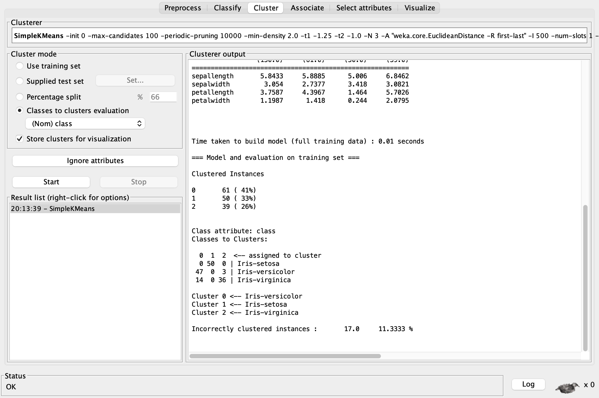

# Experiment 6: Clustering on ARFF files using WEKA

> **File:** `ClusterWeka.java`  |  **Tools:** WEKA 3.8.6, Java Development Kit (JDK) 17.0.16, MacOS

## 🎯 Aim

Implement clustering on an ARFF file using the SimpleKMeans algorithm of WEKA.

## 📘 Theory

Clustering is an unsupervised technique which groups similar records together without using any class label. SimpleKMeans chooses k starting centres, assigns every record to the nearest centre, recalculates every centre as the mean of its records and repeats this until the clusters stop changing. The aim is to make the sum of squared errors (SSE) as small as possible:

- **Number of clusters (k)**: must be given in advance; here k = 3 because the iris data has three flowers.
- **Seed**: the random starting centres depend on the seed, so the seed is fixed to get a repeatable result.
- **Remove filter**: the class attribute is removed before clustering because clustering must not see the labels.
- **Classes to clusters**: the clusters are compared with the hidden class labels to see how many records fall in the wrong cluster.

### 📐 Formulas

$$ SSE = \sum_{k=1}^{K} \sum_{x \in C_k} \lVert x - \mu_k \rVert^2 $$

$$ \mu_k = \frac{1}{|C_k|} \sum_{x \in C_k} x $$

## 🪜 Algorithm / Steps

1. Load iris.arff.
2. Remove the class attribute with the Remove filter.
3. Create SimpleKMeans with k = 3 and seed = 10 and build the clusterer.
4. Print the cluster centroids and the number of records in every cluster.
5. Evaluate the clusters against the class labels (classes to clusters evaluation).

## 💻 Code

```java
import weka.clusterers.ClusterEvaluation;
import weka.clusterers.SimpleKMeans;
import weka.core.Instances;
import weka.core.converters.ConverterUtils.DataSource;
import weka.filters.Filter;
import weka.filters.unsupervised.attribute.Remove;

public class ClusterWeka {
    public static void main(String[] args) throws Exception {
        Instances data = DataSource.read("data/iris.arff");

        Remove remove = new Remove();
        remove.setAttributeIndices("last");
        remove.setInputFormat(data);
        Instances noClass = Filter.useFilter(data, remove);

        SimpleKMeans kmeans = new SimpleKMeans();
        kmeans.setNumClusters(3);
        kmeans.setSeed(10);
        kmeans.buildClusterer(noClass);

        data.setClassIndex(data.numAttributes() - 1);
        ClusterEvaluation eval = new ClusterEvaluation();
        eval.setClusterer(kmeans);
        eval.evaluateClusterer(data);
        System.out.println(eval.clusterResultsToString());
    }
}
```

> Compile and run: `javac -cp weka.jar ClusterWeka.java` then `java -cp .:weka.jar ClusterWeka` (the `data/` folder is in this repo).

## 🖥️ Output

```text

kMeans
======

Number of iterations: 6
Within cluster sum of squared errors: 6.998114004826762

Initial starting points (random):

Cluster 0: 6.1,2.9,4.7,1.4
Cluster 1: 6.2,2.9,4.3,1.3
Cluster 2: 6.9,3.1,5.1,2.3

Missing values globally replaced with mean/mode

Final cluster centroids:
                           Cluster#
Attribute      Full Data          0          1          2
                 (150.0)     (61.0)     (50.0)     (39.0)
=========================================================
sepallength       5.8433     5.8885      5.006     6.8462
sepalwidth         3.054     2.7377      3.418     3.0821
petallength       3.7587     4.3967      1.464     5.7026
petalwidth        1.1987      1.418      0.244     2.0795


Clustered Instances

0       61 ( 41%)
1       50 ( 33%)
2       39 ( 26%)


Class attribute: class
Classes to Clusters:

  0  1  2  <-- assigned to cluster
  0 50  0 | Iris-setosa
 47  0  3 | Iris-versicolor
 14  0 36 | Iris-virginica

Cluster 0 <-- Iris-versicolor
Cluster 1 <-- Iris-setosa
Cluster 2 <-- Iris-virginica

Incorrectly clustered instances :    17.0     11.3333 %
```

<p align="center"><br/><sub>WEKA Explorer</sub></p>

## ✅ Result

SimpleKMeans (k = 3, seed = 10) converged in 6 iterations with a within-cluster sum of squared errors of 6.998 and formed clusters of 61, 50 and 39 instances. In the classes-to-clusters evaluation all 50 Iris-setosa records fall in one cluster and 17 of the 150 instances (11.33 %) are clustered wrongly, all of them between Iris-versicolor and Iris-virginica.

## 🎤 Viva Questions

**Q. What is clustering?**  
A. Grouping similar records without using a class label.

**Q. How does SimpleKMeans work?**  
A. It picks k centres, assigns every record to the nearest, moves the centres to the means and repeats.

**Q. Why is the data normalised first?**  
A. So that an attribute with large values does not dominate the distance.

**Q. What is 'classes to clusters' evaluation?**  
A. The class column is kept aside and each cluster is mapped to its majority class to see how well they match.

**Q. What is the within-cluster sum of squared errors?**  
A. The sum of squared distances of the points to their cluster centroid; smaller is better.

---
[⬅ Back to index](README.md)
