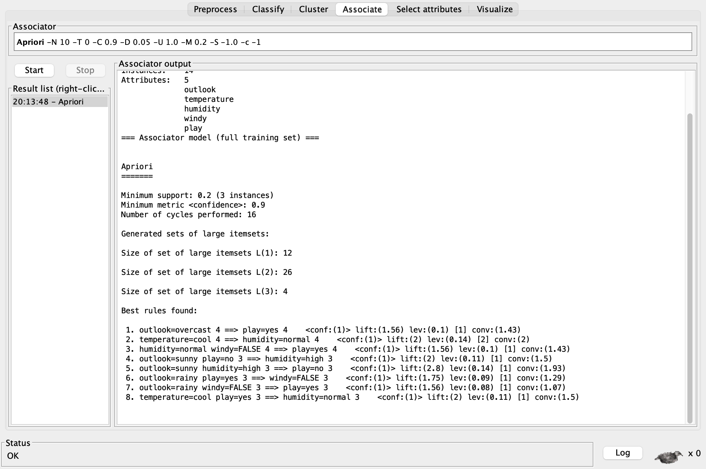

# Experiment 7: Association rules on ARFF files using WEKA

> **File:** `AprioriWeka.java`  |  **Tools:** WEKA 3.8.6, Java Development Kit (JDK) 17.0.16, MacOS

## 🎯 Aim

Implement the association rule technique using the Apriori algorithm of WEKA on an ARFF file.

## 📘 Theory

Association rule mining finds relations of the form "if A occurs then B also occurs" in a dataset. A rule is accepted only when its support and confidence are high enough. Apriori works level by level: it first finds the frequent single items, joins them to make larger candidate sets, and removes every candidate which has an infrequent subset. The measures of a rule are:

- **Support**: how often the items of the rule occur together in the dataset.
- **Confidence**: how often B is present among the records that contain A.
- **Lift**: a value above 1 shows that A and B occur together more than expected by chance.
- **Nominal data**: Apriori in WEKA works on nominal attributes, so the weather.nominal.arff dataset is used.

### 📐 Formulas

$$ \text{support}(A) = \frac{\text{count}(A)}{N} $$

$$ \text{confidence}(A \Rightarrow B) = \frac{\text{support}(A \cup B)}{\text{support}(A)} $$

$$ \text{lift}(A \Rightarrow B) = \frac{\text{confidence}(A \Rightarrow B)}{\text{support}(B)} $$

## 🪜 Algorithm / Steps

1. Load the weather.nominal.arff dataset (14 records).
2. Create an Apriori object.
3. Set the number of rules to 10, the minimum support to 20 % and the minimum confidence to 90 %.
4. Run buildAssociations() on the data.
5. Print the frequent item set sizes and the best rules with their confidence.

## 💻 Code

```java
import weka.associations.Apriori;
import weka.core.Instances;
import weka.core.converters.ConverterUtils.DataSource;

public class AprioriWeka {
    public static void main(String[] args) throws Exception {
        Instances data = DataSource.read("data/weather.nominal.arff");
        System.out.println("Dataset: " + data.relationName() + "  ("
            + data.numInstances() + " instances, "
            + data.numAttributes() + " attributes)\n");

        Apriori apriori = new Apriori();
        apriori.setNumRules(10);
        apriori.setLowerBoundMinSupport(0.2);
        apriori.setMinMetric(0.9);
        apriori.buildAssociations(data);

        System.out.println(apriori);
    }
}
```

> Compile and run: `javac -cp weka.jar AprioriWeka.java` then `java -cp .:weka.jar AprioriWeka` (the `data/` folder is in this repo).

## 🖥️ Output

```text
Dataset: weather.symbolic  (14 instances, 5 attributes)


Apriori
=======

Minimum support: 0.2 (3 instances)
Minimum metric <confidence>: 0.9
Number of cycles performed: 16

Generated sets of large itemsets:

Size of set of large itemsets L(1): 12

Size of set of large itemsets L(2): 26

Size of set of large itemsets L(3): 4

Best rules found:

 1. outlook=overcast 4 ==> play=yes 4    <conf:(1)> lift:(1.56) lev:(0.1) [1] conv:(1.43)
 2. temperature=cool 4 ==> humidity=normal 4    <conf:(1)> lift:(2) lev:(0.14) [2] conv:(2)
 3. humidity=normal windy=FALSE 4 ==> play=yes 4    <conf:(1)> lift:(1.56) lev:(0.1) [1] conv:(1.43)
 4. outlook=sunny play=no 3 ==> humidity=high 3    <conf:(1)> lift:(2) lev:(0.11) [1] conv:(1.5)
 5. outlook=sunny humidity=high 3 ==> play=no 3    <conf:(1)> lift:(2.8) lev:(0.14) [1] conv:(1.93)
 6. outlook=rainy play=yes 3 ==> windy=FALSE 3    <conf:(1)> lift:(1.75) lev:(0.09) [1] conv:(1.29)
 7. outlook=rainy windy=FALSE 3 ==> play=yes 3    <conf:(1)> lift:(1.56) lev:(0.08) [1] conv:(1.07)
 8. temperature=cool play=yes 3 ==> humidity=normal 3    <conf:(1)> lift:(2) lev:(0.11) [1] conv:(1.5)
```

<p align="center"><br/><sub>WEKA Explorer</sub></p>

## ✅ Result

On the 14 weather records Apriori generated 12 large item sets of size 1, 26 of size 2 and 4 of size 3, and reported the 10 best rules, all with confidence 1. For example outlook=overcast ⇒ play=yes (lift 1.56), temperature=cool ⇒ humidity=normal (lift 2) and outlook=sunny, humidity=high ⇒ play=no (lift 2.8).

## 🎤 Viva Questions

**Q. What is an association rule?**  
A. A rule A ⇒ B that says that records with A tend to also have B.

**Q. What are support and confidence?**  
A. Support is how often the items occur together; confidence is how often B occurs when A occurs.

**Q. What is lift?**  
A. Confidence divided by the support of B; a value above 1 means a real positive link.

**Q. Which algorithm does WEKA use here?**  
A. Apriori.

**Q. What is a frequent item set?**  
A. An item set whose support is at least the minimum support.

---
[⬅ Back to index](README.md)
