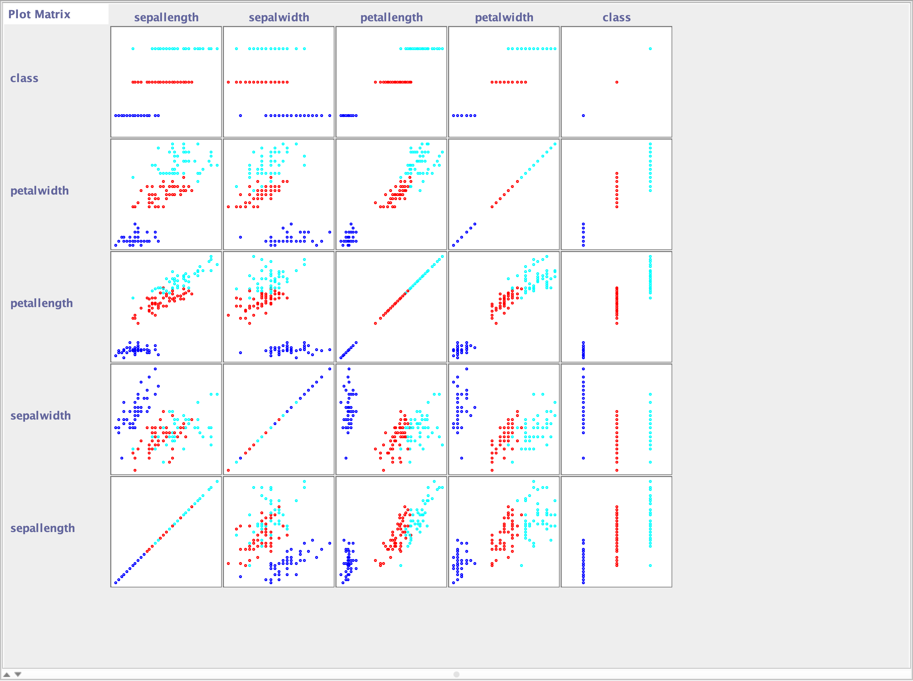
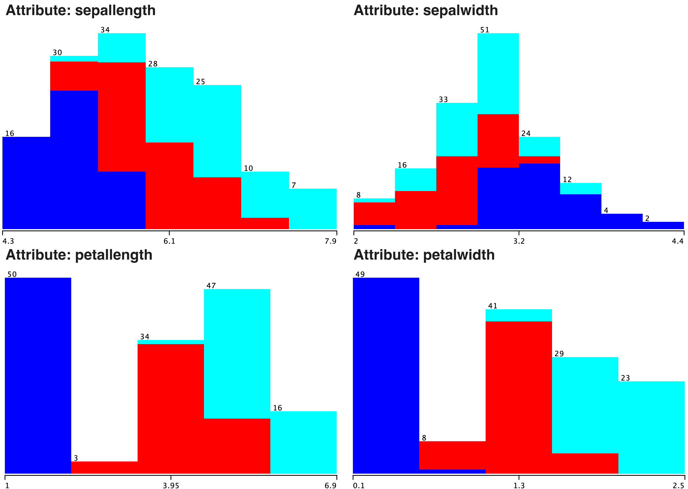
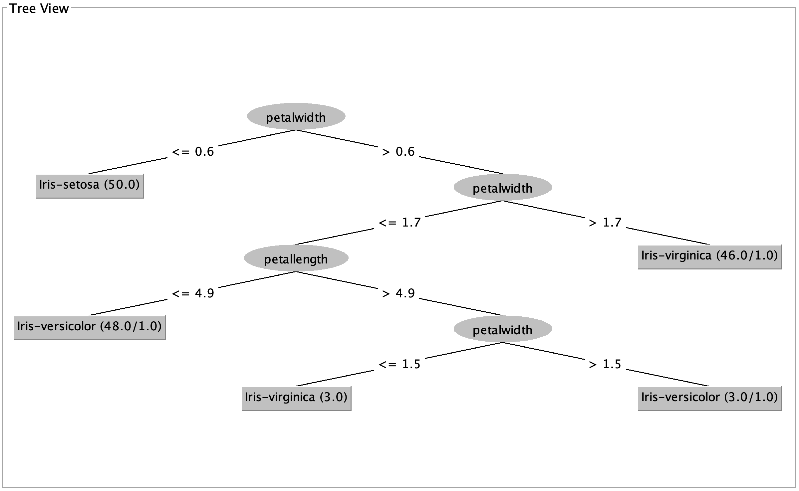

# Experiment 8: Visualization on ARFF files using WEKA

> **File:** `VisualizeWeka.java`  |  **Tools:** WEKA 3.8.6, Java Development Kit (JDK) 17.0.16, MacOS

## 🎯 Aim

Implement visualization techniques on an ARFF file using WEKA.

## 📘 Theory

Visualization turns the numbers of a dataset into pictures, so that patterns, groups and outliers can be seen quickly. WEKA has its own visual components which are used here through the Java API: the scatter plot matrix, which draws every attribute against every other attribute; the histogram of a single attribute; and the tree viewer, which draws the decision tree of a classifier.

- **Scatter plot matrix**: shows the relation between each pair of attributes; the points are coloured by class.
- **Histogram**: shows the distribution of one attribute and how the classes share it.
- **Tree visualiser**: draws the decision tree learned by J48 with its split conditions.
- **In the Explorer**: the same plots are available in the Visualize tab and in the Preprocess tab (Visualize All).

## 🪜 Algorithm / Steps

1. Load iris.arff and set the class attribute.
2. Create a ScatterPlotMatrix for the whole dataset and save it as an image.
3. Create an AttributeVisualizationPanel for each numeric attribute and save the histograms.
4. Build a J48 tree and draw it with the TreeVisualizer.
5. Study the pictures to find which attributes separate the classes best.

## 💻 Code

```java
import java.awt.Graphics2D;
import java.awt.image.BufferedImage;
import java.io.File;
import javax.imageio.ImageIO;
import javax.swing.JComponent;
import javax.swing.JFrame;
import weka.classifiers.trees.J48;
import weka.core.Instances;
import weka.core.converters.ConverterUtils.DataSource;
import weka.gui.treevisualizer.PlaceNode2;
import weka.gui.treevisualizer.TreeVisualizer;
import weka.gui.AttributeVisualizationPanel;
import weka.gui.visualize.MatrixPanel;

public class VisualizeWeka {
    static class PrintTree extends TreeVisualizer {
        PrintTree(String graph) {
            super(null, graph, new PlaceNode2());
            m_BackgroundColor = java.awt.Color.WHITE;
            m_LineColor = java.awt.Color.BLACK;
            m_FontColor = java.awt.Color.BLACK;
        }
    }

    static void save(JComponent c, int w, int h, String file)
            throws Exception {
        JFrame frame = new JFrame("WEKA");
        frame.getContentPane().add(c);
        frame.setSize(w, h);
        frame.setVisible(true);
        Thread.sleep(2500);
        if (c instanceof TreeVisualizer) {
            ((TreeVisualizer) c).fitToScreen();
            Thread.sleep(1500);
        }
        int S = 3;
        BufferedImage img = new BufferedImage(c.getWidth() * S,
            c.getHeight() * S, BufferedImage.TYPE_INT_RGB);
        Graphics2D g = img.createGraphics();
        g.scale(S, S);
        c.paint(g);
        g.dispose();
        ImageIO.write(img, "png", new File(file));
        frame.dispose();
        System.out.println("saved " + file + "  (" + img.getWidth() + " x "
                           + img.getHeight() + ")");
    }

    public static void main(String[] args) throws Exception {
        Instances data = DataSource.read("data/iris.arff");
        data.setClassIndex(data.numAttributes() - 1);

        MatrixPanel matrix = new MatrixPanel();
        matrix.setInstances(data);
        matrix.setPointSize(2);
        save(matrix, 900, 700, "out/exp8_matrix.png");

        for (int i = 0; i < data.numAttributes() - 1; i++) {
            AttributeVisualizationPanel hist =
                new AttributeVisualizationPanel();
            hist.setInstances(data);
            hist.setAttribute(i);
            save(hist, 420, 300, "out/exp8_hist" + (i + 1) + ".png");
        }

        J48 tree = new J48();
        tree.buildClassifier(data);
        TreeVisualizer tv = new PrintTree(tree.graph());
        save(tv, 800, 520, "out/exp8_tree.png");
    }
}
```

> Compile and run: `javac -cp weka.jar VisualizeWeka.java` then `java -cp .:weka.jar VisualizeWeka` (the `data/` folder is in this repo).

## 🖥️ Output

```text
saved out/exp8_matrix.png  (2700 x 2016)
saved out/exp8_hist1.png  (1260 x 816)
saved out/exp8_hist2.png  (1260 x 816)
saved out/exp8_hist3.png  (1260 x 816)
saved out/exp8_hist4.png  (1260 x 816)
saved out/exp8_tree.png  (2400 x 1476)
```

<p align="center"><br/><sub>Scatter plot matrix</sub></p>

<p align="center"><br/><sub>Histogram</sub></p>

<p align="center"><br/><sub>Decision tree</sub></p>

## ✅ Result

The scatter plot matrix shows that Iris-setosa (blue) is completely separate from the other two classes in every plot that uses petal length or petal width, while Iris-versicolor (red) and Iris-virginica (cyan) overlap a little. The histograms confirm this, and the J48 tree uses petalwidth at the root (petalwidth <= 0.6 gives Iris-setosa) and has 5 leaves.

## 🎤 Viva Questions

**Q. Why do we visualise data?**  
A. Pictures show structure, groups and outliers that tables hide.

**Q. What is a plot matrix?**  
A. A grid of scatter plots of every pair of attributes, coloured by class.

**Q. What does a histogram show?**  
A. The distribution of one attribute, here split by class.

**Q. What does the tree visualiser show?**  
A. The tests and leaves of a decision tree such as J48.

**Q. What is jitter?**  
A. A small random shift that separates overlapping points in a plot.

---
[⬅ Back to index](README.md)
