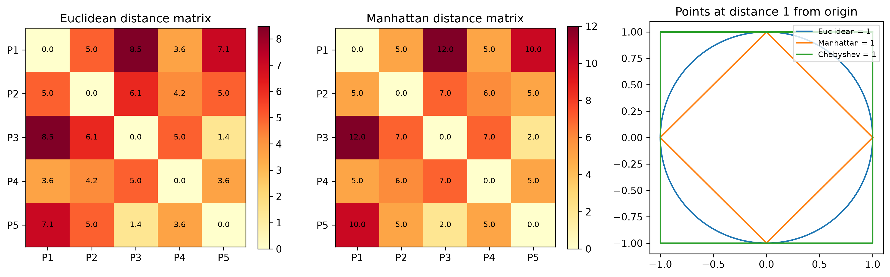

# Experiment 9: Data similarity measures

> **File:** `exp9.py`  |  **Tools:** Python 3.13, NumPy, SciPy and Matplotlib, MacOS

## 🎯 Aim

Perform data similarity measurement using the Euclidean and Manhattan distance.

## 📘 Theory

A distance (dissimilarity) measure tells how far apart two records are. A small distance means the records are similar. Distance is the basis of many mining methods such as k-nearest neighbour and clustering. For two n-dimensional points x and y the common measures are:

- **Euclidean distance**: the straight line distance between the points; it is the most widely used measure.
- **Manhattan distance**: the sum of the absolute differences, like walking along the streets of a city grid.
- **Minkowski distance**: the general form; p = 1 gives Manhattan and p = 2 gives Euclidean.
- **Chebyshev distance**: the largest difference found in any single attribute.

### 📐 Formulas

$$ d(x,y) = \sqrt{\sum_{i=1}^{n} (x_i - y_i)^2} \quad \text{(Euclidean)} $$

$$ d(x,y) = \sum_{i=1}^{n} |x_i - y_i| \quad \text{(Manhattan)} $$

$$ d(x,y) = \left(\sum_{i=1}^{n} |x_i - y_i|^p\right)^{1/p} \quad \text{(Minkowski)} $$

## 🪜 Algorithm / Steps

1. Store five points with two attributes each.
2. Write separate functions for the Euclidean, Manhattan and Minkowski distances.
3. Calculate all the distances between P1 and P3 and verify them with SciPy.
4. Build the complete distance matrix of the five points for both measures.
5. Find the most similar pair and draw the matrices as heat maps.

## 💻 Code

```python
import numpy as np
import matplotlib.pyplot as plt
from scipy.spatial import distance

def euclidean(a, b):
    return np.sqrt(np.sum((a - b) ** 2))

def manhattan(a, b):
    return np.sum(np.abs(a - b))

def minkowski(a, b, p):
    return np.sum(np.abs(a - b) ** p) ** (1 / p)

names = ["P1", "P2", "P3", "P4", "P5"]
X = np.array([[2, 10], [2, 5], [8, 4], [5, 8], [7, 5]], dtype=float)

a, b = X[0], X[2]
print("Two points      : P1 =", a, " P3 =", b)
print(f"Euclidean       : {euclidean(a, b):.4f}")
print(f"Manhattan       : {manhattan(a, b):.4f}")
print(f"Minkowski (p=3) : {minkowski(a, b, 3):.4f}")
print(f"Chebyshev       : {np.max(np.abs(a - b)):.4f}")
print(f"Check with scipy: {distance.euclidean(a, b):.4f}, "
      f"{distance.cityblock(a, b):.4f}")

n = len(X)
E_mat = np.array([[euclidean(X[i], X[j]) for j in range(n)]
                  for i in range(n)])
M_mat = np.array([[manhattan(X[i], X[j]) for j in range(n)]
                  for i in range(n)])
print("\nEuclidean distance matrix")
print(np.round(E_mat, 2))
print("\nManhattan distance matrix")
print(M_mat.astype(int))
i, j = np.unravel_index(np.argmin(E_mat + np.eye(n) * 99), E_mat.shape)
print(f"\nMost similar pair (Euclidean): {names[i]} and {names[j]} "
      f"(distance {E_mat[i, j]:.2f})")

fig, ax = plt.subplots(1, 3, figsize=(13, 4))
pairs = [(E_mat, "Euclidean"), (M_mat, "Manhattan")]
for k, (mat, title) in enumerate(pairs):
    im = ax[k].imshow(mat, cmap="YlOrRd")
    ax[k].set_xticks(range(n)); ax[k].set_xticklabels(names)
    ax[k].set_yticks(range(n)); ax[k].set_yticklabels(names)
    ax[k].set_title(f"{title} distance matrix")
    for r in range(n):
        for c in range(n):
            ax[k].text(c, r, f"{mat[r, c]:.1f}", ha="center",
                       va="center", fontsize=8)
    plt.colorbar(im, ax=ax[k], fraction=0.046)
t = np.linspace(0, 2 * np.pi, 200)
ax[2].plot(np.cos(t), np.sin(t), label="Euclidean = 1")
ax[2].plot([1, 0, -1, 0, 1], [0, 1, 0, -1, 0], label="Manhattan = 1")
ax[2].plot([1, 1, -1, -1, 1], [1, -1, -1, 1, 1], label="Chebyshev = 1")
ax[2].set_aspect("equal"); ax[2].legend(loc="upper right", fontsize=8)
ax[2].set_title("Points at distance 1 from origin")
plt.tight_layout()
plt.show()
```

## 🖥️ Output

```text
Two points      : P1 = [ 2. 10.]  P3 = [8. 4.]
Euclidean       : 8.4853
Manhattan       : 12.0000
Minkowski (p=3) : 7.5595
Chebyshev       : 6.0000
Check with scipy: 8.4853, 12.0000

Euclidean distance matrix
[[0.   5.   8.49 3.61 7.07]
 [5.   0.   6.08 4.24 5.  ]
 [8.49 6.08 0.   5.   1.41]
 [3.61 4.24 5.   0.   3.61]
 [7.07 5.   1.41 3.61 0.  ]]

Manhattan distance matrix
[[ 0  5 12  5 10]
 [ 5  0  7  6  5]
 [12  7  0  7  2]
 [ 5  6  7  0  5]
 [10  5  2  5  0]]

Most similar pair (Euclidean): P3 and P5 (distance 1.41)
```

<p align="center"><br/><sub>Figure</sub></p>

## ✅ Result

For P1 = (2, 10) and P3 = (8, 4) the Euclidean distance is 8.4853 and the Manhattan distance is 12, and both match the SciPy values. P3 and P5 are the most similar pair, with a Euclidean distance of 1.41.

## 🎤 Viva Questions

**Q. What is a similarity measure?**  
A. A number that tells how alike two data objects are; a distance is its opposite.

**Q. What is the Euclidean distance?**  
A. The square root of the sum of the squared differences of the attributes.

**Q. What is the Manhattan distance?**  
A. The sum of the absolute differences of the attributes.

**Q. What does the cosine similarity compare?**  
A. The direction of two vectors, not their size.

**Q. What is the Jaccard coefficient?**  
A. The size of the intersection of two sets divided by the size of their union.

---
[⬅ Back to index](README.md)
