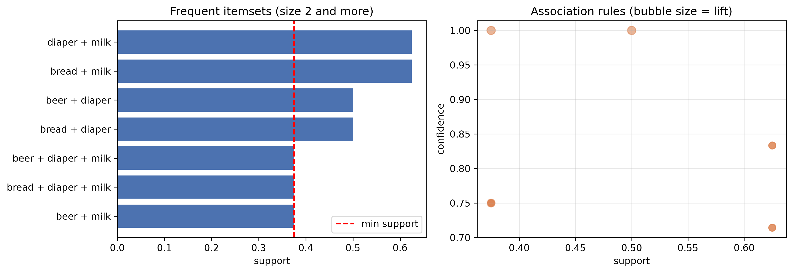

# Experiment 10: Apriori algorithm for frequent itemsets

> **File:** `exp10.py`  |  **Tools:** Python 3.13, Matplotlib, MacOS

## 🎯 Aim

Implement the Apriori algorithm to mine frequent item sets and generate association rules.

## 📘 Theory

Apriori finds the item sets which appear together in at least a minimum number of transactions. It is based on the Apriori property: every subset of a frequent item set must also be frequent. Therefore, if an item set is infrequent, all the sets that contain it can be ignored. The algorithm repeats two steps level by level: join the frequent sets of size k to get candidates of size k+1, and prune the candidates which have an infrequent subset. The measures are:

- **Candidate set**: an item set which may be frequent and whose count is still to be checked.
- **Frequent item set**: a set whose support is at least the minimum support (here 37.5 %, i.e. 3 of 8 transactions).
- **Rule generation**: every frequent set is split into a left and a right part and kept when the confidence is at least 70 %.
- **Lift**: shows whether the rule is better than chance.

### 📐 Formulas

$$ \text{support}(A) = \frac{\text{count}(A)}{N} $$

$$ \text{confidence}(A \Rightarrow B) = \frac{\text{support}(A \cup B)}{\text{support}(A)} $$

$$ \text{lift}(A \Rightarrow B) = \frac{\text{confidence}(A \Rightarrow B)}{\text{support}(B)} $$

## 🪜 Algorithm / Steps

1. Store eight market basket transactions.
2. Count the support of every single item and keep the frequent ones (L1).
3. Join the frequent sets to make bigger candidates, prune them and keep the frequent ones (L2, L3) until no new set remains.
4. Generate all rules from the frequent sets and keep those with confidence of 70 % or more.
5. Print the item sets and rules with support, confidence and lift and draw the charts.

## 💻 Code

```python
from itertools import combinations

transactions = [
    {"bread", "milk"},
    {"bread", "diaper", "beer", "eggs"},
    {"milk", "diaper", "beer", "cola"},
    {"bread", "milk", "diaper", "beer"},
    {"bread", "milk", "diaper", "cola"},
    {"bread", "milk", "diaper"},
    {"milk", "diaper", "beer"},
    {"bread", "milk", "eggs"},
]
N = len(transactions)
MIN_SUP, MIN_CONF = 0.375, 0.7

def count(itemset):
    return sum(1 for t in transactions if itemset <= t)

items = sorted({i for t in transactions for i in t})
level = [frozenset([i]) for i in items]
frequent, k = {}, 1
while level:
    survivors = {s: count(s) for s in level if count(s) / N >= MIN_SUP}
    if not survivors:
        break
    print(f"L{k}: {len(level)} candidates -> {len(survivors)} frequent")
    ordered = sorted(survivors.items(),
                     key=lambda x: (-x[1], sorted(x[0])))
    for s, c in ordered:
        print(f"     {sorted(s)}  count = {c}  support = {c / N:.3f}")
    frequent.update(survivors)
    k += 1
    keys = list(survivors)
    level = {a | b for a in keys for b in keys if len(a | b) == k}
    level = [c for c in level
             if all(frozenset(s) in survivors
                    for s in combinations(c, k - 1))]

print(f"\nRules with confidence >= {MIN_CONF:.0%}")
rules = []
for s, c in frequent.items():
    if len(s) < 2:
        continue
    for r in range(1, len(s)):
        for lhs in map(frozenset, combinations(s, r)):
            rhs = s - lhs
            conf = c / frequent[lhs]
            lift = conf / (frequent[rhs] / N)
            if conf >= MIN_CONF:
                rules.append((sorted(lhs), sorted(rhs), c / N, conf, lift))
for lhs, rhs, sup, conf, lift in sorted(rules, key=lambda r: -r[3]):
    print(f"  {str(lhs):<22} -> {str(rhs):<12} sup={sup:.3f} "
          f"conf={conf:.2f} lift={lift:.2f}")
print("\nTotal frequent itemsets:", len(frequent), " Rules:", len(rules))

import matplotlib.pyplot as plt
fig, ax = plt.subplots(1, 2, figsize=(12, 4.2))
big = sorted(((sorted(s), c / N) for s, c in frequent.items()
              if len(s) >= 2), key=lambda x: x[1])
ax[0].barh([" + ".join(s) for s, _ in big], [v for _, v in big],
           color="#4c72b0")
ax[0].axvline(MIN_SUP, color="red", ls="--", label="min support")
ax[0].set_xlabel("support"); ax[0].legend()
ax[0].set_title("Frequent itemsets (size 2 and more)")
ax[1].scatter([r[2] for r in rules], [r[3] for r in rules],
              s=[60 * r[4] for r in rules], alpha=0.6, color="#dd8452")
ax[1].set_xlabel("support"); ax[1].set_ylabel("confidence")
ax[1].set_title("Association rules (bubble size = lift)")
ax[1].grid(alpha=0.3)
plt.tight_layout()
plt.show()
```

## 🖥️ Output

```text
L1: 6 candidates -> 4 frequent
     ['milk']  count = 7  support = 0.875
     ['bread']  count = 6  support = 0.750
     ['diaper']  count = 6  support = 0.750
     ['beer']  count = 4  support = 0.500
L2: 6 candidates -> 5 frequent
     ['bread', 'milk']  count = 5  support = 0.625
     ['diaper', 'milk']  count = 5  support = 0.625
     ['beer', 'diaper']  count = 4  support = 0.500
     ['bread', 'diaper']  count = 4  support = 0.500
     ['beer', 'milk']  count = 3  support = 0.375
L3: 2 candidates -> 2 frequent
     ['beer', 'diaper', 'milk']  count = 3  support = 0.375
     ['bread', 'diaper', 'milk']  count = 3  support = 0.375

Rules with confidence >= 70%
  ['beer']               -> ['diaper']   sup=0.500 conf=1.00 lift=1.33
  ['beer', 'milk']       -> ['diaper']   sup=0.375 conf=1.00 lift=1.33
  ['bread']              -> ['milk']     sup=0.625 conf=0.83 lift=0.95
  ['diaper']             -> ['milk']     sup=0.625 conf=0.83 lift=0.95
  ['beer']               -> ['milk']     sup=0.375 conf=0.75 lift=0.86
  ['bread', 'diaper']    -> ['milk']     sup=0.375 conf=0.75 lift=0.86
  ['beer']               -> ['diaper', 'milk'] sup=0.375 conf=0.75 lift=1.20
  ['beer', 'diaper']     -> ['milk']     sup=0.375 conf=0.75 lift=0.86
  ['milk']               -> ['bread']    sup=0.625 conf=0.71 lift=0.95
  ['milk']               -> ['diaper']   sup=0.625 conf=0.71 lift=0.95

Total frequent itemsets: 11  Rules: 10
```

<p align="center"><br/><sub>Figure</sub></p>

## ✅ Result

The algorithm found 4 frequent items, 5 frequent pairs and 2 frequent triples, which makes 11 frequent item sets, and generated 10 rules. The strongest rule is {beer} ⇒ {diaper} with confidence 1.00 and lift 1.33.

## 🎤 Viva Questions

**Q. What is the Apriori property?**  
A. Every subset of a frequent item set is also frequent.

**Q. How does Apriori work?**  
A. It finds frequent single items, builds candidate pairs, keeps the frequent ones, and goes on level by level.

**Q. How are rules generated?**  
A. Each frequent item set is split into a left and a right part, and rules with enough confidence are kept.

**Q. What is a candidate item set?**  
A. A set that may be frequent and still has to be counted.

**Q. Why does pruning save work?**  
A. Candidates with an infrequent subset are discarded without counting them.

---
[⬅ Back to index](README.md)
