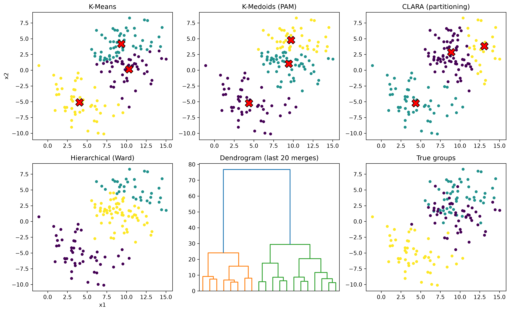

# Experiment 11: Clustering algorithms

> **File:** `exp11.py`  |  **Tools:** Python 3.13, NumPy, SciPy, scikit-learn and Matplotlib, MacOS

## 🎯 Aim

Develop the clustering algorithms K-Means, K-Medoids, Partitioning (CLARA) and Hierarchical clustering.

## 📘 Theory

Clustering divides the data into groups so that the records of a group are similar to each other and different from the records of other groups. Partitioning methods such as K-Means and K-Medoids create k groups directly. Hierarchical methods build a tree of clusters (a dendrogram) which can be cut at any level. K-Means tries to minimise the sum of squared errors:

- **K-Means**: every cluster is represented by its mean (centroid), which is fast but sensitive to outliers.
- **K-Medoids (PAM)**: every cluster is represented by one real data point (the medoid), which makes it more robust to outliers.
- **Partitioning (CLARA)**: runs PAM on several small random samples and keeps the best medoids, so it works on large data.
- **Hierarchical (agglomerative)**: starts with every record as its own cluster and repeatedly merges the two closest clusters (Ward linkage here).

### 📐 Formulas

$$ SSE = \sum_{k=1}^{K} \sum_{x \in C_k} \lVert x - \mu_k \rVert^2 $$

$$ \mu_k = \frac{1}{|C_k|} \sum_{x \in C_k} x $$

## 🪜 Algorithm / Steps

1. Generate 150 two-dimensional points that form three overlapping groups.
2. Write K-Means: choose random centres, assign points, update centres and repeat until they stop moving.
3. Write K-Medoids (PAM): swap medoids with other points as long as the total cost decreases.
4. Write CLARA: apply PAM to five samples of 40 points and choose the medoids with the lowest cost on all the data.
5. Apply Ward hierarchical clustering, cut it at three clusters and compare all the methods with the true groups.

## 💻 Code

```python
import numpy as np
import matplotlib.pyplot as plt
from sklearn.datasets import make_blobs
from sklearn.metrics import adjusted_rand_score
from scipy.cluster.hierarchy import linkage, fcluster, dendrogram

X, y_true = make_blobs(n_samples=150, centers=3, cluster_std=2.3,
                       random_state=4)
K = 3
rng = np.random.default_rng(5)

def dist(A, B):
    return np.sqrt(((A[:, None, :] - B[None, :, :]) ** 2).sum(axis=2))

def kmeans(X, k, iters=100):
    cent = X[rng.choice(len(X), k, replace=False)]
    for it in range(1, iters + 1):
        labels = dist(X, cent).argmin(axis=1)
        new = np.array([X[labels == j].mean(axis=0) for j in range(k)])
        if np.allclose(new, cent):
            break
        cent = new
    sse = sum(((X[labels == j] - cent[j]) ** 2).sum() for j in range(k))
    return labels, cent, sse, it

def kmedoids(X, k, iters=50):
    D = dist(X, X)
    med = list(rng.choice(len(X), k, replace=False))
    cost = D[:, med].min(axis=1).sum()
    for it in range(1, iters + 1):
        improved = False
        for mi in range(k):
            for cand in range(len(X)):
                if cand in med:
                    continue
                trial = med.copy(); trial[mi] = cand
                c = D[:, trial].min(axis=1).sum()
                if c < cost:
                    med, cost, improved = trial, c, True
        if not improved:
            break
    return D[:, med].argmin(axis=1), X[med], cost, it

def clara(X, k, samples=5, size=40):
    best = None
    for _ in range(samples):
        idx = rng.choice(len(X), size, replace=False)
        _, med, _, _ = kmedoids(X[idx], k)
        cost = dist(X, med).min(axis=1).sum()
        if best is None or cost < best[0]:
            best = (cost, med)
    cost, med = best
    return dist(X, med).argmin(axis=1), med, cost

lab_km, c_km, sse, it_km = kmeans(X, K)
lab_md, c_md, cost_md, it_md = kmedoids(X, K)
lab_cl, c_cl, cost_cl = clara(X, K)
Z = linkage(X, method="ward")
lab_hc = fcluster(Z, K, criterion="maxclust") - 1

print(f"Data: {len(X)} points, k = {K}")
print(f"K-Means   : converged in {it_km} iterations, SSE = {sse:.1f}")
print(f"K-Medoids : converged in {it_md} passes,     cost = {cost_md:.1f}")
print(f"CLARA     : best of 5 samples,          cost = {cost_cl:.1f}")
print(f"Hierarchical (Ward) : cut at {K} clusters")
print("\nCluster sizes")
for name, lab in [("K-Means", lab_km), ("K-Medoids", lab_md),
                  ("CLARA", lab_cl), ("Hierarchical", lab_hc)]:
    print(f"  {name:<13}", np.bincount(lab))
print("\nAgreement with true groups (Adjusted Rand Index)")
for name, lab in [("K-Means", lab_km), ("K-Medoids", lab_md),
                  ("CLARA", lab_cl), ("Hierarchical", lab_hc)]:
    print(f"  {name:<13} {adjusted_rand_score(y_true, lab):.3f}")

fig, ax = plt.subplots(2, 3, figsize=(13, 8))
panels = [("K-Means", lab_km, c_km), ("K-Medoids (PAM)", lab_md, c_md),
          ("CLARA (partitioning)", lab_cl, c_cl),
          ("Hierarchical (Ward)", lab_hc, None)]
for a, (title, lab, cen) in zip(ax.ravel()[:4], panels):
    a.scatter(X[:, 0], X[:, 1], c=lab, cmap="viridis", s=18)
    if cen is not None:
        a.scatter(cen[:, 0], cen[:, 1], marker="X", s=200, c="red",
                  edgecolor="black")
    a.set_title(title)
dendrogram(Z, ax=ax[1, 1], truncate_mode="lastp", p=20, no_labels=True)
ax[1, 1].set_title("Dendrogram (last 20 merges)")
ax[1, 2].scatter(X[:, 0], X[:, 1], c=y_true, cmap="viridis", s=18)
ax[1, 2].set_title("True groups")
ax[0, 0].set_ylabel("x2"); ax[1, 0].set_xlabel("x1")
plt.tight_layout()
plt.show()
```

## 🖥️ Output

```text
Data: 150 points, k = 3
K-Means   : converged in 5 iterations, SSE = 1362.0
K-Medoids : converged in 4 passes,     cost = 392.4
CLARA     : best of 5 samples,          cost = 407.2
Hierarchical (Ward) : cut at 3 clusters

Cluster sizes
  K-Means       [45 56 49]
  K-Medoids     [51 58 41]
  CLARA         [71 53 26]
  Hierarchical  [50 34 66]

Agreement with true groups (Adjusted Rand Index)
  K-Means       0.579
  K-Medoids     0.637
  CLARA         0.458
  Hierarchical  0.544
```

<p align="center"><br/><sub>Figure</sub></p>

## ✅ Result

All four algorithms divided the 150 points into three clusters. The Adjusted Rand Index against the true groups was 0.579 for K-Means, 0.637 for K-Medoids, 0.458 for CLARA and 0.544 for hierarchical clustering, so K-Medoids was the closest to the true groups on this overlapping data.

## 🎤 Viva Questions

**Q. How does K-Medoids differ from K-Means?**  
A. The centre of a K-Medoids cluster is an actual data point.

**Q. What is CLARA?**  
A. PAM applied to several random samples of the data, so it works for large data sets.

**Q. What is hierarchical clustering?**  
A. Every point starts alone and the two closest clusters are merged again and again.

**Q. What is a dendrogram?**  
A. A tree that shows the order and distance of the merges.

**Q. What is Ward linkage?**  
A. It merges the pair of clusters that raises the within-cluster variance the least.

---
[⬅ Back to index](README.md)
