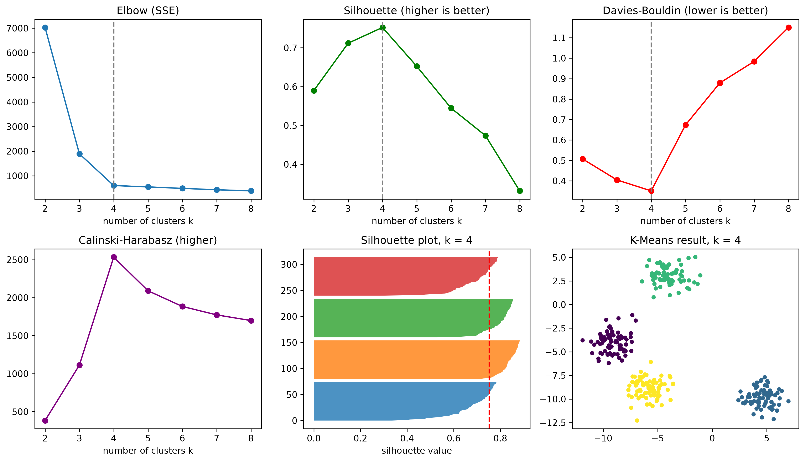

# Experiment 12: Validity measures for clustering

> **File:** `exp12.py`  |  **Tools:** Python 3.13, NumPy, scikit-learn and Matplotlib, MacOS

## 🎯 Aim

Apply validity measures to evaluate the quality of clustering.

## 📘 Theory

Cluster validity measures tell how good a clustering is and help to choose the best number of clusters. Internal measures use only the data and the clusters, for example the silhouette coefficient, the Davies-Bouldin index and the Calinski-Harabasz index. External measures compare the clusters with known class labels, for example the Adjusted Rand Index (ARI) and the normalised mutual information. Two important internal indices are:

- **Silhouette**: a(i) is the average distance of the point to its own cluster and b(i) to the nearest other cluster; values near 1 are good.
- **Davies-Bouldin index**: the average similarity of each cluster with its most similar cluster; lower is better.
- **Calinski-Harabasz index**: ratio of between-cluster to within-cluster spread; higher is better.
- **SSE (elbow method)**: total squared distance to the centres; the best k is where the curve bends like an elbow.
- **ARI and NMI**: external measures where 1.0 means that the clusters are identical to the true classes.

### 📐 Formulas

$$ s(i) = \frac{b(i) - a(i)}{\max(a(i),\, b(i))} $$

$$ DB = \frac{1}{K} \sum_{i=1}^{K} \max_{j \ne i} \frac{s_i + s_j}{d_{ij}} $$

## 🪜 Algorithm / Steps

1. Generate 300 points that belong to four groups.
2. Run K-Means for k = 2 to 8.
3. Calculate SSE, silhouette, Davies-Bouldin and Calinski-Harabasz for every k and print them in a table.
4. Select the best k and compare its clusters with the true labels using ARI, NMI, homogeneity and completeness.
5. Plot the four curves, the silhouette plot and the final clustering.

## 💻 Code

```python
import numpy as np
import matplotlib.pyplot as plt
from sklearn.cluster import KMeans
from sklearn.datasets import make_blobs
from sklearn.metrics import (silhouette_score, silhouette_samples,
                             davies_bouldin_score, calinski_harabasz_score,
                             adjusted_rand_score,
                             normalized_mutual_info_score,
                             homogeneity_score, completeness_score)

X, y_true = make_blobs(n_samples=300, centers=4, cluster_std=1.0,
                       random_state=21)

ks = range(2, 9)
sse, sil, dbi, chi = [], [], [], []
for k in ks:
    km = KMeans(n_clusters=k, n_init=10, random_state=0).fit(X)
    sse.append(km.inertia_)
    sil.append(silhouette_score(X, km.labels_))
    dbi.append(davies_bouldin_score(X, km.labels_))
    chi.append(calinski_harabasz_score(X, km.labels_))

print(f"{'k':>2} | {'SSE':>9} | {'Silhouette':>10} | {'Davies-B':>8} | "
      f"{'Calinski-H':>10}")
print("-" * 52)
for k, a, b, c, d in zip(ks, sse, sil, dbi, chi):
    print(f"{k:>2} | {a:>9.1f} | {b:>10.3f} | {c:>8.3f} | {d:>10.1f}")
best = list(ks)[int(np.argmax(sil))]
print(f"\nBest k by silhouette  : {best}")
print("Best k by Davies-Bouldin (lowest) :", list(ks)[int(np.argmin(dbi))])
print("Best k by Calinski-Harabasz       :", list(ks)[int(np.argmax(chi))])

labels = KMeans(n_clusters=best, n_init=10, random_state=0).fit_predict(X)
print(f"\nExternal measures for k = {best}")
print(f"  Adjusted Rand Index : {adjusted_rand_score(y_true, labels):.3f}")
nmi = normalized_mutual_info_score(y_true, labels)
print(f"  Normalised Mutual Info : {nmi:.3f}")
print(f"  Homogeneity         : {homogeneity_score(y_true, labels):.3f}")
print(f"  Completeness        : {completeness_score(y_true, labels):.3f}")

fig, ax = plt.subplots(2, 3, figsize=(13, 7.5))
ax[0, 0].plot(list(ks), sse, "o-"); ax[0, 0].set_title("Elbow (SSE)")
ax[0, 1].plot(list(ks), sil, "o-", color="green")
ax[0, 1].set_title("Silhouette (higher is better)")
ax[0, 2].plot(list(ks), dbi, "o-", color="red")
ax[0, 2].set_title("Davies-Bouldin (lower is better)")
ax[1, 0].plot(list(ks), chi, "o-", color="purple")
ax[1, 0].set_title("Calinski-Harabasz (higher)")
for a in ax[0]:
    a.axvline(best, color="gray", ls="--")
    a.set_xlabel("number of clusters k")
ax[1, 0].set_xlabel("number of clusters k")
s = silhouette_samples(X, labels)
y0 = 0
for c in range(best):
    v = np.sort(s[labels == c])
    ax[1, 1].fill_betweenx(np.arange(y0, y0 + len(v)), 0, v, alpha=0.8)
    y0 += len(v) + 5
ax[1, 1].axvline(silhouette_score(X, labels), color="red", ls="--")
ax[1, 1].set_title(f"Silhouette plot, k = {best}")
ax[1, 1].set_xlabel("silhouette value")
ax[1, 2].scatter(X[:, 0], X[:, 1], c=labels, cmap="viridis", s=15)
ax[1, 2].set_title(f"K-Means result, k = {best}")
plt.tight_layout()
plt.show()
```

## 🖥️ Output

```text
 k |       SSE | Silhouette | Davies-B | Calinski-H
----------------------------------------------------
 2 |    7029.0 |      0.590 |    0.507 |      383.4
 3 |    1892.5 |      0.712 |    0.405 |     1112.6
 4 |     602.5 |      0.752 |    0.351 |     2533.3
 5 |     547.7 |      0.652 |    0.673 |     2090.4
 6 |     486.5 |      0.545 |    0.879 |     1884.4
 7 |     430.7 |      0.474 |    0.984 |     1773.2
 8 |     385.2 |      0.332 |    1.150 |     1698.8

Best k by silhouette  : 4
Best k by Davies-Bouldin (lowest) : 4
Best k by Calinski-Harabasz       : 4

External measures for k = 4
  Adjusted Rand Index : 1.000
  Normalised Mutual Info : 1.000
  Homogeneity         : 1.000
  Completeness        : 1.000
```

<p align="center"><br/><sub>Figure</sub></p>

## ✅ Result

All the three internal measures (silhouette 0.752, Davies-Bouldin 0.351 and Calinski-Harabasz 2533.3) agree that k = 4 is the best number of clusters, and the elbow of the SSE curve is also at k = 4. For this k the ARI, NMI, homogeneity and completeness are all 1.000, so the clusters are the same as the true groups.

## 🎤 Viva Questions

**Q. Why do we validate clusters?**  
A. To know whether the clustering is good and which number of clusters is right.

**Q. What is an internal validity measure?**  
A. A measure that uses only the data and the clusters, such as the silhouette or SSE.

**Q. What is an external validity measure?**  
A. A measure that compares the clusters with known labels, such as the adjusted Rand index or purity.

**Q. What does the silhouette coefficient show?**  
A. How much closer a point is to its own cluster than to the next one.

**Q. How do we read the Davies-Bouldin index?**  
A. Lower is better; it is the average similarity of each cluster to its most similar one.

---
[⬅ Back to index](README.md)
